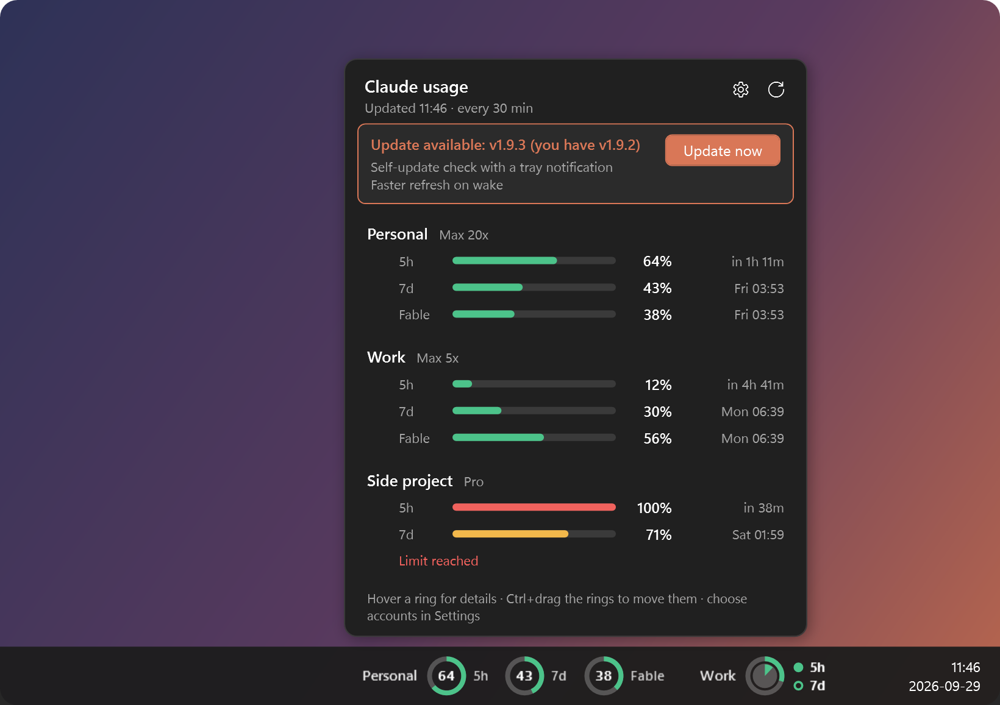
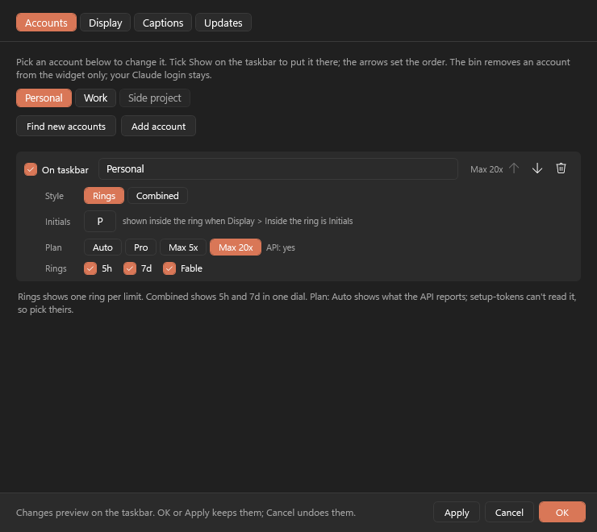

<div align="center">


# Claude Usage Widget for Windows 11

**Your Claude 5-hour, 7-day and Fable limits as small rings on the Windows 11 taskbar.**
One account or several, updated in the background, in one click.

[](https://github.com/mrcsXndr/claude-usage-widget/releases/latest)
[](#install)
[](#how-it-works)
[](LICENSE)



</div>

## Features

- **Rings on the taskbar.** Each ring is green up to 70%, amber up to 90% and red after that. Hover a ring for its numbers, which ring is which, and its reset times.
- **Compact when you have many accounts.** Choose what goes **inside the ring** (nothing, the account's initials, or the percentage) and what goes **next to the ring** (nothing, the caption, or the percentage); any combination works. Rings only, or small initials inside and nothing beside, takes about half the width of the full look. Initials are an automatic letter (two where first letters clash) or your own. **Size** is Compact, Normal or Large; Large also shows when each limit resets (next to the ring you can also pick "Reset in" or "Reset day + time"). Spacing is Tight, Normal or Wide, the account name can sit left, right or be hidden, and you choose whether 5h or 7d is the inner ring of a combined dial. Hover a ring for what it is. An account can hide itself while it is at its limit. Dividers between accounts are optional.
- **Multiple accounts.** Tick the accounts you want on the taskbar and they sit side by side, each with its name.
- **All limits in one click.** The list shows each account's 5-hour window, 7-day window and Fable weekly limit, with countdowns to the resets.
- **Finds your accounts.** On first run it picks up the Claude Code logins on your PC (and [xndr-claude](https://github.com/mrcsXndr/xndr-claude) accounts if you use it).
- **Two styles.** **Rings** gives each limit its own ring. **Combined** puts one limit as a pie in the middle and the other as the ring around it, with both percentages beside it. You choose which limit goes in the middle.
- **Settings you can edit.** Rename accounts, choose each account's style and rings, choose what shows inside and next to the rings, the size, account names and dividers, rename the captions, set how often it refreshes, and turn animations on or off.
- **Stays out of the way.** Refreshes every 30 minutes by default (5 minutes at the most frequent), and never more than once a minute when you refresh by hand. Catches up after sleep. Hides during full-screen apps. Follows the light or dark theme.
- **Nothing to install besides itself.** It's plain PowerShell and WPF, which ship with Windows, so there are no runtimes, services or admin rights involved.

## Install

Open **PowerShell** (press Start, type `powershell`, press Enter) and paste:

```powershell
irm https://github.com/mrcsXndr/claude-usage-widget/releases/latest/download/install.ps1 | iex
```

That's it. The rings appear on your taskbar, left of the clock, and they start with Windows from then on.

<details>
<summary>Prefer not to paste commands?</summary>

1. Download **[ClaudeUsageWidget.zip](https://github.com/mrcsXndr/claude-usage-widget/releases/latest/download/ClaudeUsageWidget.zip)** from the latest release and unzip it.
2. Double-click **`Install.cmd`**. If Windows asks whether to run it, choose **Run**.

Running either one again updates you to the latest release and keeps your settings.
</details>

**Uninstall** by right-clicking the rings and choosing **Uninstall…**. You can also do it from **Settings → Apps → Installed apps → Claude Usage Widget → Uninstall**. [More options](#uninstall)

## Use

| | |
| --- | --- |
| **Click** the rings | Open the account list |
| **Tick** an account | Show it on the taskbar |
| **⚙ Settings** | Rename accounts, set their initials, pick Rings or Combined, choose rings, choose the size and what shows inside and next to the rings, toggle names, dividers and animations, set the refresh interval. Settings opens as a normal, resizable window with tabs. Changes preview on the taskbar right away; **OK** or **Apply** keeps them and **Cancel** (or Esc, or the close button) undoes them |
| **⟳** | Refresh now (at most once a minute) |
| **Ctrl + drag** | Move the rings along the taskbar |
| **Right-click** | Refresh · Settings · Scan for accounts · Start with Windows · Uninstall · Exit |

<div align="center">

</div>

## Accounts

The widget finds accounts on its own:

- **Claude Code logins.** It reads `%USERPROFILE%\.claude\.credentials.json`, which is where Claude Code keeps its login on Windows. It also checks any other `.claude*` folder in your user profile (for example one per account set up with `CLAUDE_CONFIG_DIR`). Accounts are named after the email they're logged in with.
- **[xndr-claude](https://github.com/mrcsXndr/xndr-claude)** accounts, only if you happen to have it installed. It is optional; nothing else depends on it, and the widget shows it as a source only when it is found on the PC.

You can also manage accounts from **Settings** (the cog): **Find new accounts** lists logins not added yet, **Add account** takes a name, a source and a plan, and the bin removes one. OK or Apply keeps the changes. The sources are:

- **Claude Code login**: pick the folder that holds the login (`.credentials.json`).
- **Token**: paste a token from `claude setup-token`. The widget asks first ("Save this token as the Windows user environment variable `CLAUDE_USAGE_TOKEN_<NAME>`? It stays on this PC."), and only after you press Approve does it store the token there. The token is never written to the config file or the log; the config only holds the variable name. Setup tokens can't report their plan, so pick it yourself. Removing such an account offers to delete the variable too.
- **xndr-claude account**: only listed when xndr-claude is installed. After you log in to another account, right-click the rings and choose **Scan for accounts**. If the same account turns up twice, you can hide one of them by adding `"hidden": true` to it in the config file (see below).

<details>
<summary>Other token sources (config file)</summary>

Everything is stored in `%APPDATA%\claude-usage-widget\config.json`. To open it, right-click the rings and choose **Open config file…**. Each account says where its token comes from:

```json
{
  "refreshMinutes": 30,
  "showPercents": true,
  "showNames": true,
  "showCaptions": true,
  "animations": true,
  "captions": { "5h": "5h", "7d": "7d", "fable": "Fable" },
  "accounts": [
    { "name": "claude-code", "label": "Personal", "source": "claude-code", "taskbar": true, "limits": ["5h", "7d", "fable"] },
    { "name": "work",  "label": "Work",  "source": "xndr-claude", "style": "combined", "pie": "5h", "short": "Wk" },
    { "name": "vault", "label": "Vault", "source": "command", "command": "op read op://Private/claude/token" },
    { "name": "ci",    "label": "CI",    "source": "env", "env": "CLAUDE_CI_TOKEN", "fable": false }
  ]
}
```

| `source` | Where the token comes from |
| --- | --- |
| `claude-code` | Claude Code's login. Add `"dir"` for a config folder other than `~/.claude`. |
| `xndr-claude` | Optional. `xndr-claude token <name>`. Add `"account"` if the name there is different. |
| `command` | Whatever the command prints, for example a password manager CLI. |
| `env` | An environment variable (read from your user environment, so one set while the widget runs works). The Token source in Settings creates these as `CLAUDE_USAGE_TOKEN_<NAME>`. |

`"refreshMinutes"` sets how often it refreshes, 5 at the lowest. `"size"` is `"compact"` (default), `"normal"` or `"large"`. `"inside"` (`"none"`, `"initials"`, `"percent"`) and `"next"` (`"none"`, `"caption"`, `"percent"`) set what shows inside and next to each ring; when they are missing, the older `"showPercents": false` means initials inside and nothing beside, and `"showCaptions": false` drops the captions. `"next"` also accepts `"resetin"` and `"resetat"`. `"names"` (`"left"`, `"right"`, `"hidden"`) places the account names (older `"showNames": false` means hidden), `"spacing"` is `"tight"`, `"normal"` or `"wide"`, `"innerWindow"` (`"5h"` or `"7d"`) is the inner ring of combined dials, `"hideAtLimit": true` hides an account while a window is at 100%, `"showLegend": true` shows the legend under the list, and `"showDividers": true` draws a line between accounts. `"animations"` turns the popup's fade and slide on or off.

For each account, `"style": "combined"` shows 5h and 7d in one dial, and `"pie"` (`"5h"` or `"7d"`) picks which one goes in the middle (the inner ring when the percentage is not inside). `"short"` sets the 1-2 initials shown inside its ring; leave it out for automatic ones. `"limits"` picks the rings in the Rings style. `"hidden": true` leaves an account out of the list and off the taskbar. `"fable": false` makes that account skip the Fable probe (see below).
</details>

## How it works

For each account the widget asks Anthropic for the current limits. There are two ways to do that, and it tries the free one first:

1. **Usage API (free).** `GET api.anthropic.com/api/oauth/usage` returns every limit and doesn't use any of your allowance. This works for **Claude Code logins**.
2. **Probe (tiny).** Tokens made with `claude setup-token` aren't allowed to call the usage API ([anthropics/claude-code#81015](https://github.com/anthropics/claude-code/issues/81015)). For those, the widget sends a 1-token request and reads the limits from the rate-limit headers on the reply. It sends that request to Fable, because only then does the reply include the Fable weekly limit. That costs about 35 tokens per account per refresh. If Fable isn't available on an account, it uses Haiku instead.

Hover an account in the list to see which method it used.

**Claude Code logins expire.** The widget only ever reads the login and never renews it, because renewing would sign Claude Code out. If a login has expired, open Claude Code once and the widget picks up the new one.

## Privacy

- Tokens are kept in memory only as long as one request takes. They're never written to disk, logged, shown, or passed on a command line.
- The only network calls go to `api.anthropic.com`, plus `github.com` when you install or update.
- Settings are stored in `%APPDATA%\claude-usage-widget`. Uninstalling removes them. Your Claude logins are never touched.

## Uninstall

Any one of these removes the widget, its shortcuts, its Settings → Apps entry and its settings. Your Claude logins and tokens aren't touched.

- Right-click the rings and choose **Uninstall…**.
- Go to **Settings → Apps → Installed apps**, find **Claude Usage Widget**, and choose **Uninstall**.
- Paste this into PowerShell:

  ```powershell
  & "$env:LOCALAPPDATA\Programs\ClaudeUsageWidget\uninstall.ps1"
  ```

To keep your settings for a later reinstall, add `-KeepSettings` to that command.

## Troubleshooting

| | |
| --- | --- |
| **Rings don't appear** | Run the installer again. Errors are logged to `%APPDATA%\claude-usage-widget\widget.log`. |
| **Popup acts oddly** | Set the environment variable `CUW_DEBUG=1` and restart the widget. It then logs each open/close decision to `widget.log`. Please attach that log to an [issue](https://github.com/mrcsXndr/claude-usage-widget/issues). |
| **"Login expired"** | Open Claude Code once so it renews the login. |
| **"token invalid"** | That token was revoked. Log in again, or make a new setup-token. |
| **Rings cover a tray icon** | Hold Ctrl and drag them somewhere else. |
| **Taskbar on another screen** | For now the widget sits on the main screen's taskbar only. |

## For developers

```powershell
.\ClaudeUsageWidget.ps1 -Demo          # made-up accounts, no network, your config untouched
.\ClaudeUsageWidget.ps1 -Once          # every account's usage as JSON, no UI (never includes tokens)
.\ClaudeUsageWidget.ps1 -Snapshot docs # re-render the README images (docs/)
.\tools\Build-Icon.ps1                 # re-render assets\icon.ico
.\tools\Build-Release.ps1              # build dist\ClaudeUsageWidget.zip for a release
```

| File | What it does |
| --- | --- |
| `ClaudeUsageWidget.ps1` | The widget: taskbar rings, account list, settings (WPF) |
| `lib/Usage.ps1` | Account discovery, token sources, usage API and probe, with no UI |
| `install.ps1` / `Install.cmd` / `uninstall.ps1` | Per-user install to `%LOCALAPPDATA%\Programs`, with Start menu, startup and Settings → Apps entries |

The code is kept ASCII-only so the Windows PowerShell 5.1 that ships with Windows reads it correctly. Pull requests are welcome.

## Changelog

See [CHANGELOG.md](CHANGELOG.md) for what changed in each release.

## License

[MIT](LICENSE). This project isn't affiliated with Anthropic.
